# Budżet domowy 0.10.1

Aplikacja na Maca i Windows do analizy domowego budżetu na podstawie wyciągów bankowych (mBank, ING, MT940, Revolut) i skanów paragonów.
Gotowe paczki: `dist/BudzetDomowy-0.10.1.zip` (Mac) i `dist/BudzetDomowy-0.10.1-windows.zip` (Windows 10/11, z wbudowanym Pythonem; instrukcja w CZYTAJ.txt w archiwum). Program uruchamiający dla Windows: `windows/launcher.c`. Kod źródłowy: `BudzetDomowy.app/Contents/Resources/app`.

## Zrzuty ekranu (dane przykładowe)

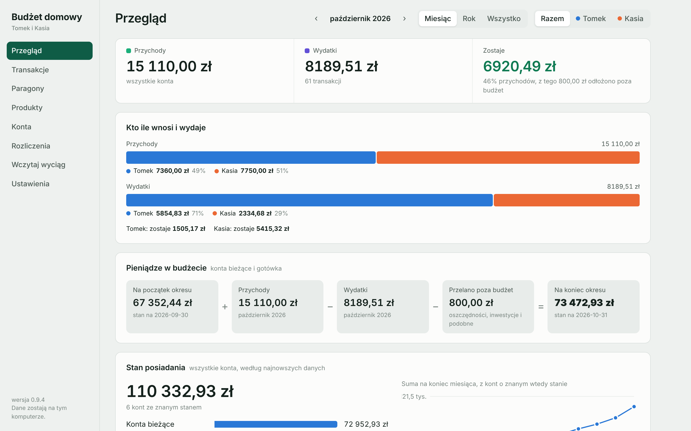
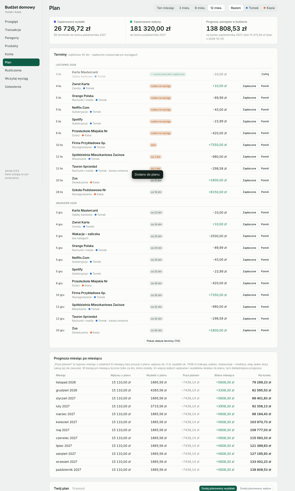
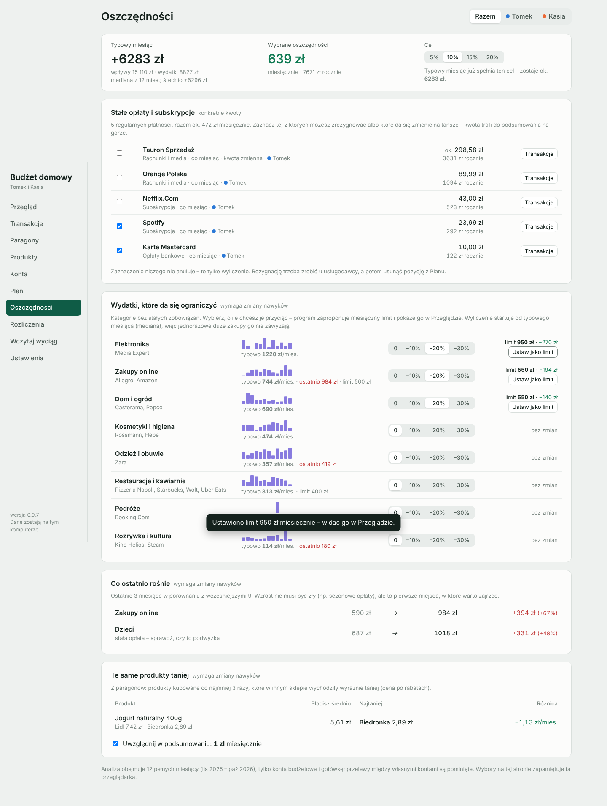
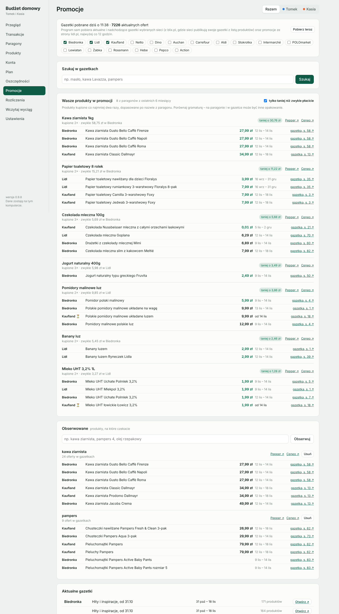
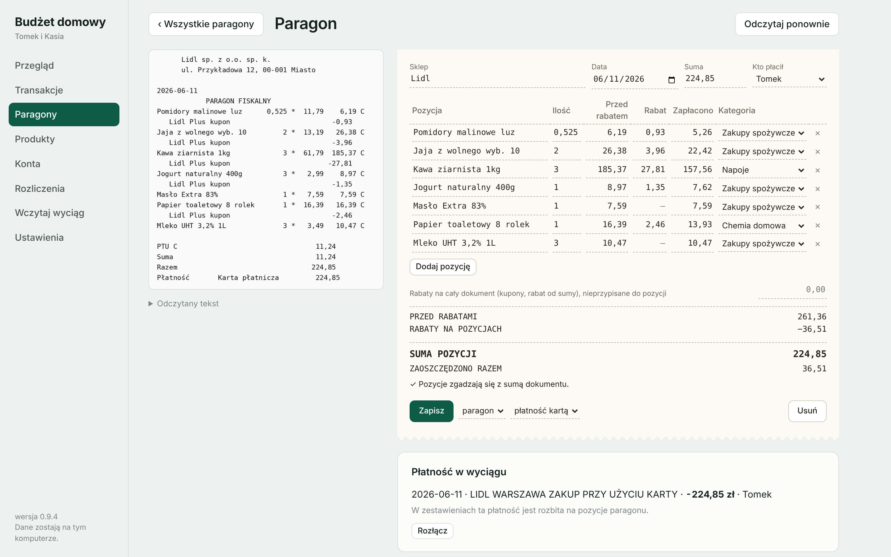
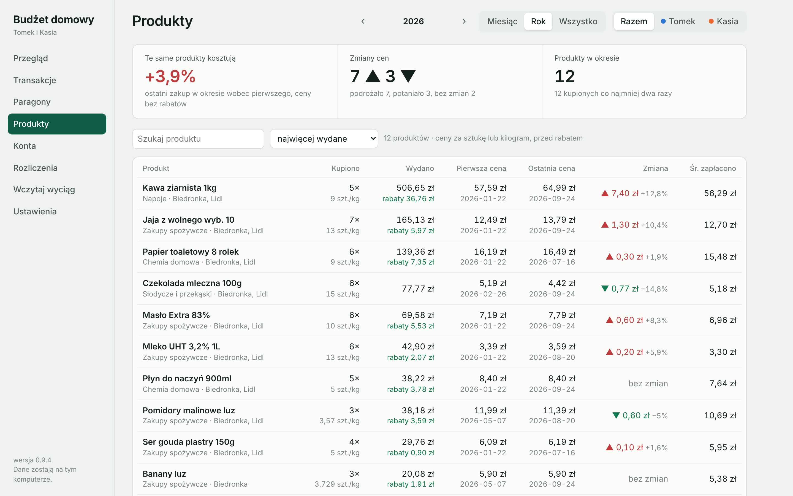
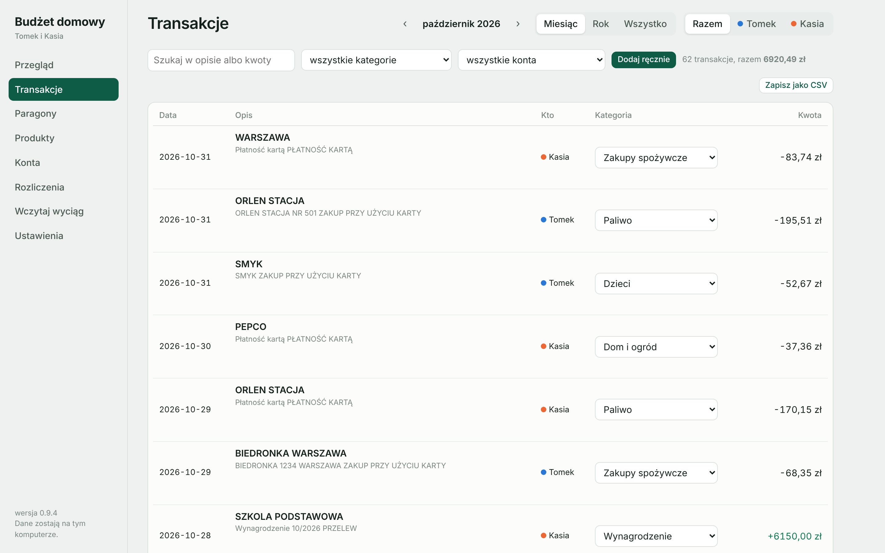
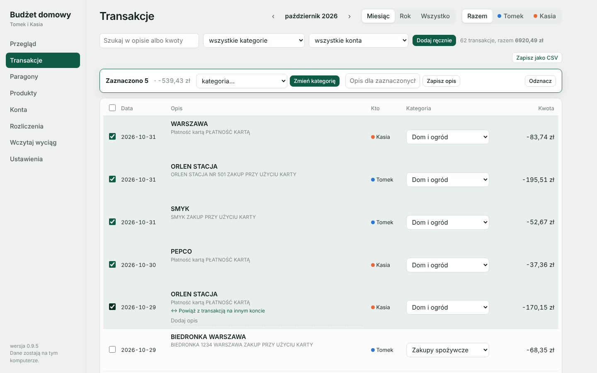
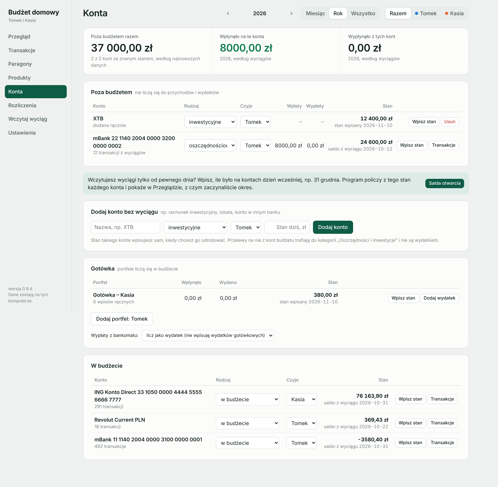
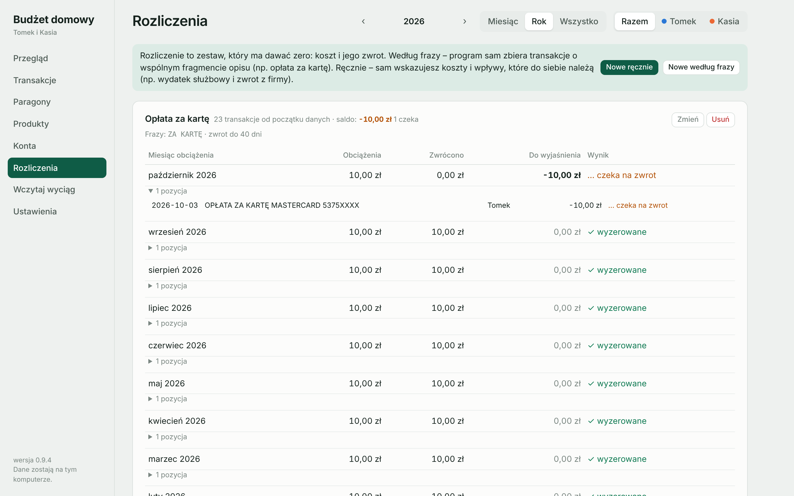
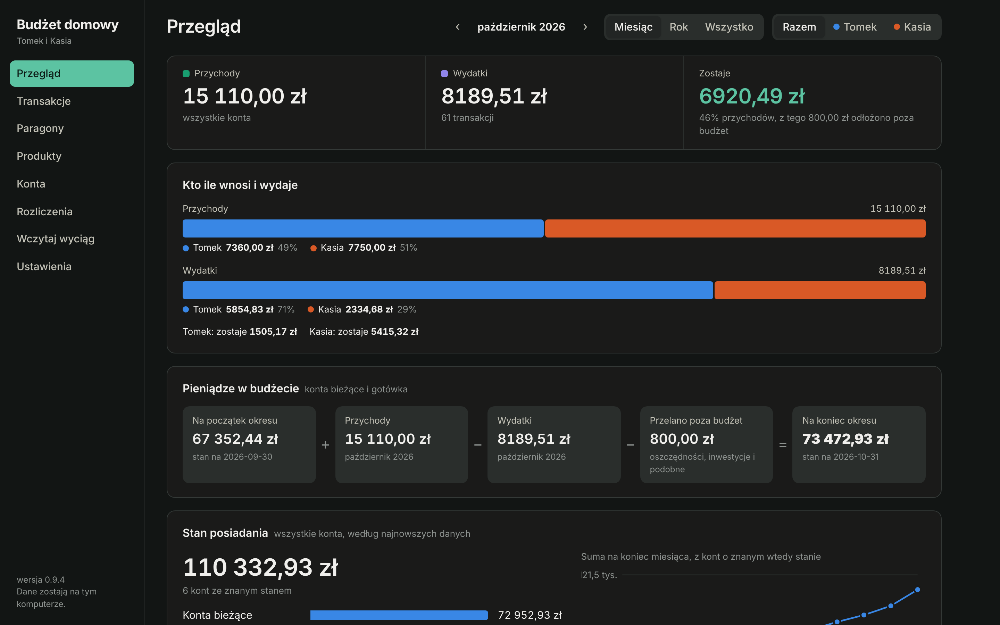

Instalacja
1. Przeciągnij "BudzetDomowy.app" do folderu Programy.
2. Pierwsze uruchomienie: kliknij program prawym przyciskiem i wybierz "Otwórz"
   (na macOS 15 i nowszych: Ustawienia systemowe > Prywatność i ochrona > "Otwórz mimo to").
   Program nie jest podpisany przez Apple, dlatego system pyta o zgodę.
3. Program otwiera się w przeglądarce pod adresem http://127.0.0.1:8765 i działa tylko na tym komputerze.

Wymagania
- macOS 12 lub nowszy.
- Narzędzia Apple (Command Line Tools): w Terminalu "xcode-select --install".
  Dają Pythona i odczyt tekstu z paragonów. Jeśli masz już Pythona z Homebrew, program go użyje,
  ale narzędzia Apple nadal są potrzebne do odczytu paragonów.

Dane
- Wszystko zapisuje się w ~/Library/Application Support/BudzetDomowy (baza budzet.db i folder paragony).
- Kopia zapasowa = kopia tego folderu.

Zamykanie
- Ustawienia > "Zamknij program". Samo zamknięcie karty przeglądarki zostawia program w tle.

Co nowego w 0.2.0
- Rabaty z paragonów: osobna kolumna przy każdej pozycji, rabaty na cały dokument, zestawienie "Zaoszczędzone na promocjach".
- Faktury (zdjęcie lub PDF): sprzedawca, data, kwota do zapłaty, pozycje, rabaty.
- Łączenie z wyciągiem: szersze okno dat, odporność na brak sumy w tym samym wierszu, wyjaśnienie, dlaczego nie znaleziono płatności.

Co nowego w 0.3.0
- Zakładka Produkty: zestawienie produktów za wybrany okres, zmiana ceny (pierwszy i ostatni zakup), historia ceny każdego produktu na wykresie.
- E-paragony z aplikacji Lidl Plus: daty, pozycje w dwóch wierszach, kupony i rabaty, kaucje za opakowania, kwota płatności.
- Ten sam plik wczytany drugi raz jest pomijany.

Co nowego w 0.4.0
- Zakładka Konta: konta poza budżetem (oszczędnościowe, 800+ i świadczenia, inwestycyjne, inne). Nie liczą się do przychodów i wydatków.
- Konto poza budżetem można wczytać z wyciągu (wybór przy pierwszym imporcie) albo dodać ręcznie i wpisywać jego stan.
- Przelew z konta budżetu na konto poza budżetem trafia do kategorii "Oszczędności i inwestycje"; Przegląd pokazuje, ile odłożono.

Co nowego w 0.5.0
- Opisy transakcji: pole "Dodaj opis" pod każdą transakcją na liście; opisy są przeszukiwane i trafiają do eksportu CSV.
- Wpisy ręczne: wydatki i przychody spoza wyciągów (Transakcje > "Dodaj ręcznie").
- Gotówka: portfel dla każdej osoby ze stanem; wypłaty z bankomatu mogą go zasilać zamiast liczyć się jako wydatek (Konta > Gotówka).
- Przegląd: "Stan posiadania" – suma i podział na konta bieżące, gotówkę, oszczędności, 800+, inwestycje oraz zmiana w czasie.

Co nowego w 0.6.0
- Zakładka Rozliczenia: pary, które mają dawać zero (np. opłata za kartę i jej zwrot). Program łączy obciążenie ze zwrotem na tę samą kwotę
  i pokazuje miesiąc po miesiącu, co się wyzerowało, co czeka na zwrot, a gdzie zwrotu zabrakło. Przegląd ostrzega o brakujących zwrotach.

Co nowego w 0.7.0
- Salda otwarcia: Konta > "Salda otwarcia" – stan każdego konta na koniec poprzedniego roku (albo innego dnia sprzed pierwszego wyciągu).
- Przegląd > "Pieniądze w budżecie": stan na początek okresu + przychody − wydatki − przelewy poza budżet = stan na koniec okresu.
- Ponowne wczytanie wyciągu za ten sam okres (np. w wersji z saldem) niczego nie dubluje: istniejące transakcje dostają saldo
  i zachowują kategorie, opisy i paragony. To samo konto jest rozpoznawane po numerze także w innym układzie pliku.

Co nowego w 0.8.0
- Rozliczenia ręczne: Rozliczenia > "Nowe ręcznie" – sam wskazujesz koszty i zwroty, które do siebie należą (np. wydatek służbowy i zwrot z firmy).
  Wyszukiwanie osobno po stronie kosztów i wpływów: po opisie, kontrahencie, własnym opisie albo kwocie.
- Nowa kategoria "Wydatki do zwrotu" (poza budżetem), domyślna dla takich zestawów.

Co nowego w 0.9.0
- Wyciągi MT940 (pliki .sta) z ING, mBanku i innych banków – z saldem po każdej operacji. Transakcje wczytane wcześniej z CSV są rozpoznawane.
- Pośrednicy płatności (PayPro/Przelewy24, PayU, Tpay, PayPal…): sprzedawca jest brany z tytułu przelewu, reguła ostrzega przed nazwą pośrednika.
- Okno reguły: podpowiedzi fraz z opisu i podgląd, które transakcje pasują.
- Wydatek może dostać tylko kategorię wydatku, wpływ tylko przychodu (kategorie "poza budżetem" pasują do obu).
- Lepsza kategoryzacja: więcej sklepów i usług, zwroty od sklepów jako "Zwroty", sprzedaż na Vinted/OLX/Allegro jako "Inne przychody",
  a dla nierozpoznanych transakcji – kategoria, którą wcześniej wybrałeś ręcznie dla tego samego sprzedawcy.
- Ustawienia: kategorie pogrupowane na wydatki, przychody i poza budżetem, z kolejnością (strzałki, "Sortuj A–Z").

Co nowego w 0.9.1
- Dokładniejszy odczyt paragonów: każdy wiersz jest sprawdzany rachunkiem ilość × cena = wartość, a źle odczytane cyfry
  (przekreślone 0 czytane jako 8, sklejone liczby, nadmiarowe znaki) są poprawiane. Rabaty "Lidl Plus voucher", kaucje i zwroty kaucji.
- Widok paragonu: kolumna "Przed rabatem" obok rabatu i kwoty zapłaconej, podsumowanie przed rabatami.
- Po aktualizacji: Paragony > "Odczytaj ponownie niesprawdzone".

Co nowego w 0.9.2
- Odczyt na Macu: zero odczytane jako "@" lub "Q@" jest rozpoznawane; rabaty "Lidl Plus voucher" odczytane z błędem (np. -8,99 zamiast -0,99)
  są poprawiane na podstawie typowego udziału rabatu w cenie; do czterech poprawek naraz przy sprawdzaniu sumy.
- W widoku paragonu, gdy suma się nie zgadza, podejrzanie duże rabaty są wyróżnione.

Co nowego w 0.9.3
- Poprawka: w mBanku "PRZELEW WEWNĘTRZNY" oznacza przelew między dowolnymi klientami mBanku, a nie przelew do siebie.
  Wpisz w Ustawieniach > Osoby imię i nazwisko każdej osoby tak, jak widnieje na przelewach – wtedy przelewy do siebie
  i między Wami są rozpoznawane po nazwisku, a wpłaty od klientów i płatności dla innych klientów mBanku liczą się normalnie.
- Nowa kategoria przychodu "Wypłaty z firmy".

Co nowego w 0.10.1
- Poprawka: po aktualizacji w tle mógł dalej działać poprzedni program, przez co nowe funkcje (np. lista zakupów)
  zwracały „Nieznane polecenie”. Teraz uruchomienie programu z ikony zamyka starszą wersję i startuje nową,
  a działający program sam przełącza się na nową wersję, gdy wykryje podmienione pliki.

Co nowego w 0.10.0
- Lista zakupów w zakładce Promocje: przycisk „+” przy każdej ofercie, dopisywanie własnych pozycji, ilości,
  podział na sklepy i szacunkowa kwota.
- Eksport listy: „Kopiuj listę” (pozycja w linii, opcjonalnie ze sklepem, ceną i terminem promocji),
  „Kopiuj w jednej linii” (po przecinku), „Udostępnij…”, „Wyślij e-mailem” i plik .txt.
  Listonic nie ma importu z innych programów – listę wkleja się w pole dodawania produktu
  (Przypomnienia, Notatki, Google Keep i Todoist dzielą wklejony tekst na pozycje same).

Co nowego w 0.9.9
- Nowa zakładka Promocje:
  - program sam pobiera aktualne i nadchodzące gazetki wybranych sieci (Biedronka, Lidl, Kaufland, Netto, Dino,
    Auchan, Carrefour, Aldi i inne) – z blix.pl, gdzie sieci publikują gazetki razem z listą produktów i cen –
    oraz bieżące promocje spożywcze ze strony lidl.pl; odświeża je najwyżej co 12 godzin,
  - „Wasze produkty w promocji”: produkty z paragonów kupione co najmniej dwa razy, z ceną, jaką zwykle płacicie,
    i informacją, gdzie są teraz taniej,
  - obserwowane produkty (np. „kawa ziarnista”, „pampers”), wyszukiwarka po wszystkich gazetkach,
    linki do Pepper.pl i Ceneo (sklepy internetowe),
  - wgrywanie własnej gazetki (PDF albo zdjęcie) dla sklepów spoza listy.
  Ceny warto sprawdzić w gazetce (link przy każdej ofercie) – na paragonie i w gazetce bywa inna gramatura.

Co nowego w 0.9.8
- Nowa zakładka Oszczędności – gdzie i ile można zaoszczędzić, na podstawie 12 ostatnich pełnych miesięcy:
  - typowy miesiąc (mediana wpływów i wydatków) i cel: ile brakuje, żeby odkładać 5, 10, 15 lub 20% dochodów,
  - stałe opłaty i subskrypcje z kosztem rocznym i wykrywaniem podwyżek – zaznacz, z czego rezygnujesz,
  - kategorie do ograniczenia (restauracje, zakupy online, ubrania…): wybierz −10/−20/−30% i ustaw to jako limit,
  - co ostatnio rośnie, drobne zakupy do 30 zł, opłaty bankowe po odjęciu zwrotów,
  - te same produkty z paragonów taniej w innym sklepie,
  - podsumowanie wybranych oszczędności miesięcznie i rocznie.

Co nowego w 0.9.7
- Wersja na Windows 10 i 11 (osobne archiwum BudzetDomowy-0.9.7-windows.zip).
- Ręczne oznaczanie cyklicznych transakcji: w Transakcjach „Powtarza się – dodaj do planu” przy transakcji
  albo „Dodaj do planu jako cykliczne” dla zaznaczonych. Program sam policzy, jak często się powtarza i ile zwykle wynosi.
- Lepsze wykrywanie stałych wpływów i płatności, które przychodzą w kilku przelewach albo z dodatkowymi
  wypłatami w trakcie miesiąca (np. pensja w dwóch częściach, ZFŚS, nagrody).
- Wyszukiwanie transakcji nie zwraca uwagi na polskie znaki i wielkość liter („szkola” znajdzie „SZKOŁA”).

Co nowego w 0.9.6
- Nowa zakładka Plan:
  - wykrywa płatności i wpływy, które powtarzają się regularnie (czynsz, prąd, abonamenty, raty, wynagrodzenia),
    pokazuje typową kwotę i następny termin; jednym kliknięciem dodajesz je do planu albo pomijasz,
  - własne planowane wydatki i wpływy: jednorazowe albo powtarzane co tydzień, miesiąc, kwartał, pół roku, rok,
  - terminy z oznaczeniem, co już zapłacono – program rozpoznaje płatność na wyciągu po frazie i kwocie;
    można też oznaczyć ręcznie albo pominąć termin,
  - prognoza pieniędzy w budżecie na 1, 3, 6 lub 12 miesięcy: plan plus typowe wpływy i wydatki spoza planu
    (mediana z ostatnich 6 miesięcy).

Co nowego w 0.9.5
- Edycja grupowa w Transakcjach: zaznacz kilka transakcji (Shift zaznacza od–do, pole w nagłówku – wszystkie widoczne,
  „Zaznacz wszystkie z filtra” – całe wyniki wyszukiwania) i zmień im naraz kategorię albo opis.
- Reguły mogą działać także na transakcje z kategorią ustawioną ręcznie: pole w oknie reguły
  albo przycisk „Zastosuj do wszystkich” przy regule w Ustawieniach.
- Konflikty reguł: okno reguły i lista reguł pokazują, które reguły pasują do tych samych transakcji
  z inną kategorią i która wygrywa (dłuższa fraza).
- Zakres dat: przycisk „Zakres” – dowolne miesiące od–do, także kilka lat, oraz gotowe zakresy
  (ostatnie 3/6/12 miesięcy, od początku roku, poprzedni rok, ostatnie 2/3/5 lat).
- Porównanie w Przeglądzie: ten sam okres rok wcześniej, poprzedni okres tej samej długości albo dowolny inny okres.
  Gdy bieżący miesiąc jeszcze trwa, porównuje tyle samo dni. Kategorie posortowane według największej zmiany.
- Wykres miesięczny obejmuje cały wybrany zakres.

Co nowego w 0.9.4
- Wyciągi Revolut (Excel albo CSV, po polsku lub angielsku). Wczytywane są operacje w złotych.
- Doładowania Revolut kartą z mBanku/ING są łączone z wpływem na Revolut i przestają być wydatkiem.
- Przy każdej transakcji widać, z którą transakcją na innym koncie jest połączona ("↔"), z przyciskiem "Rozłącz".
  Transakcje, których program nie połączył sam, można powiązać ręcznie: "↔ Powiąż z transakcją na innym koncie".
